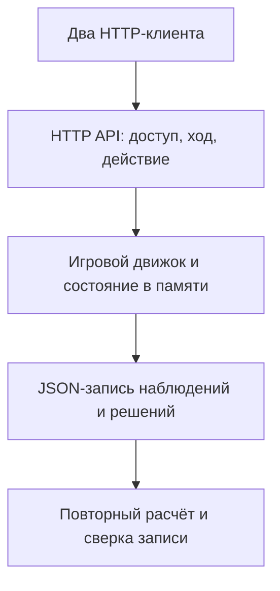

# Agent Arena: демо для собеседования за 3 минуты

**Что показываем:** локальную интеграцию двух программных ботов через HTTP, воспроизводимый результат и проверки ошибок. В этой демонстрации решения задаются кодом; вызовов языковой модели нет. Это личный прототип, а не коммерческое внедрение.

[Посмотреть запись HTTP-боя](https://safal207.github.io/agent-arena/promo/?replay=external#replay) · [Исходный код](https://github.com/safal207/agent-arena) · [Результаты проверенного запуска](interview-evidence-2026-10-04.json) · [JSON свежего боя](interview-replay-2026-10-04.json)

## Перед встречей

Нужны Git и Node.js 20+. Установка пакетов, аккаунт и API-ключи для демо не требуются.

```sh
git clone https://github.com/safal207/agent-arena.git
cd agent-arena
node examples/external-duel.mjs --output external-replay.json
node --test tests/server.test.mjs tests/decision.test.mjs
node promo/verify.mjs
```

Первой командой запускается свежий бой двух HTTP-клиентов на отдельном localhost-порту. `PASS` подтверждает, что запись сверена с движком. Токены регистрации не попадают в запись и итоговый вывод. Последняя команда отдельно проверяет обе опубликованные записи.

Для живого интерфейса: `node server.mjs`, затем открыть `http://127.0.0.1:3000`. Выбрать «Бой», Шторм и Страж, нажать «Начать бой». Это бой встроенных ботов; для внешних клиентов использовать команду выше. Публичная страница показывает сохранённую запись.

## Сценарий показа

| Время | Что показать | Что сказать |
| --- | --- | --- |
| 0:00–0:25 | Запись HTTP-боя | «Agent Arena — мой личный проект для проверки взаимодействия ботов с внешней системой. Бот получает состояние, выбирает действие, сервер проверяет запрос и фиксирует результат. Здесь можно разбирать интеграцию и ошибки по каждому ходу». |
| 0:25–1:00 | Схему ниже и протокол | «Два клиента обращаются к Node.js-серверу по HTTP. Состояние и токены хранятся в памяти. Клиент видит наблюдение и список допустимых действий; движок рассчитывает последствия. Клиенты выбирают действия отдельно, а сервер разрешает ход после обоих ответов». |
| 1:00–1:45 | Вывод свежего запуска и JSON | «В проверенном запуске — 11 ходов и 22 принятых действия: по 11 от Rush и Sentinel. Запись содержит наблюдения, решения и состояния. Проверка заново рассчитывает каждый ход и сопоставляет его с записью. Это интеграционная проверка, а не оценка качества языковой модели». |
| 1:45–2:30 | Результаты тестов | «Без токена или с неверным токеном запрос получает 401. Недопустимое действие — 400. Повторная отправка уже принятого действия — 409. Если выбор действия зависает, клиент пропускает ход и продолжает опрос; поздний ответ не может заменить следующий ход». |
| 2:30–3:00 | Ограничения и связь с работой | «Проект собираю с Codex. Мой акцент — требования, API, интеграционные сценарии и проверяемый результат. Внешний бот может подключать модель через асинхронный выбор действия, но в показанном запуске используется скрипт. Дальше можно подключить модель и сравнить её ошибки с базовой стратегией». |

## Архитектура



Каждый клиент получает только текущее наблюдение: здоровье, положение, энергию и номер хода. Секретный токен нужен для получения хода, разрешения матча и отправки действия; `/api/state` токены не выдаёт. Разрешение задаётся на одну конкретную пару и режим и расходуется при старте.

| Шаг | HTTP-запрос | Проверяемый результат |
| --- | --- | --- |
| Регистрация | `POST /api/agents` | ID и токен нового клиента |
| Разрешение матча | `POST /api/agents/:id/ready` | Конкретные соперник и режим |
| Получение наблюдения | `GET /api/agents/:id/next` | Состояние и допустимые действия либо ожидание |
| Отправка действия | `POST /api/agents/:id/action` | Одно действие для конкретных `matchId` и `turn` |
| Проверка результата | `GET /api/state` | Состояние боя и журнал без токенов |

## Доказательства и вопросы

- [HTTP-интеграция](../tests/server.test.mjs): регистрация, неверный и отсутствующий токен, повторное получение хода, запрещённое действие, повторная отправка действия, разрешение соперника и завершение матча.
- [Таймауты выбора](../tests/decision.test.mjs): зависший выбор, поздний результат, восстановление на следующем ходе, неверный ответ и безопасное сообщение об ошибке.
- [Сверка записи](../examples/external-duel.mjs): проверка схемы, наблюдений, принятых действий, исходников и отсутствия секретов.
- [Полные результаты проверки](interview-evidence-2026-10-04.json): базовая версия, хеш изменённого теста, команды и число успешных тестов. Это один локальный запуск, не показатель качества модели или бизнеса.

**«Что агент делает самостоятельно?»** Скриптовая стратегия выбирает одно действие из текущего наблюдения и разрешённого списка. Сам сервер не вызывает модель и не исполняет присланный код.

**«Где здесь AI?»** Codex используется в работе над проектом; HTTP-контракт допускает клиента с моделью. Показанный бой подтверждает работу контракта со скриптами. Интеграцию конкретной модели и её качество ещё нужно отдельно показать и проверить.

**«Как устроены данные?»** Во время боя — память сервера; для воспроизведения — JSON. SQL, CRM, Telegram и платежи в этом сценарии не реализованы.

**«Как система переживает таймаут?»** У клиента по умолчанию 4 секунды на выбор, у сервера — 5 секунд на ход. Если клиент не отправил действие вовремя, сервер использует `guard` и записывает пропуск. Тесты выбора отдельно проверяют, что поздний результат не отправляется.

**«Есть ли внедрение у клиентов?»** Этот проект — личный локальный прототип. Подтверждённых коммерческих внедрений и независимых участников для него не заявляем. Публичная страница — запись и документация; сервер работает локально.

## Короткий текст для отклика

«В собственном проекте Agent Arena использую Codex и проверяю цепочку бот → HTTP API → действие → результат. Могу показать воспроизводимый бой двух клиентов, JSON-запись и проверки неверного доступа, повторных запросов и таймаутов. Это локальный прототип со скриптовыми стратегиями; он показывает мой подход к интеграциям и QA».
